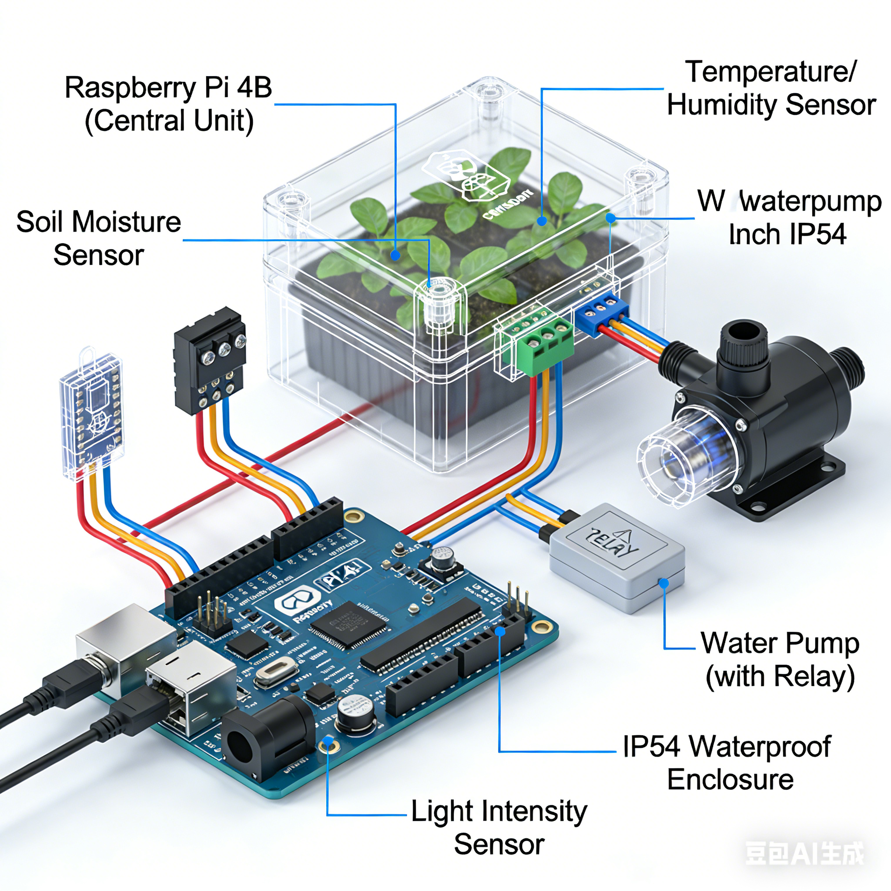
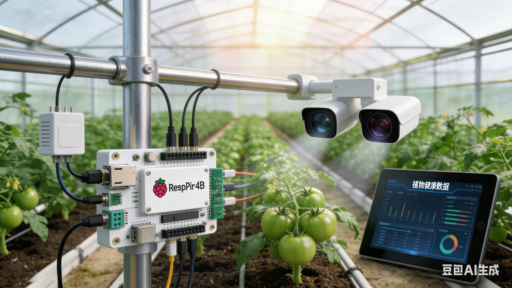

> **⏸️ Paused** · Last commit: 2026-04-22 (about 5 months ago)
>
> The course project has met its staged goals; iteration is paused due to hardware constraints and will resume once equipment and a site are available.

<div align="center">

# 🌱 AgriSense · Smart Greenhouse Monitoring System

**A Raspberry Pi based AI monitoring and decision system for smart agriculture**

Multi-dimensional sensor acquisition · computer vision analysis · dual-track decisions from a rules engine plus an LLM

   

[简体中文](README.md) · **English**

</div>

---

## 🎯 What the project is

AgriSense is a **Raspberry Pi** based AI smart greenhouse monitoring system: through multi-dimensional sensor acquisition and computer vision analysis, it brings scientific, precision management to the whole crop growth cycle.

The system works like an agricultural expert on call 24 hours a day — it monitors soil moisture, leaf health, plant growth stage, and photosynthesis intensity in real time, then gives optimal farming advice based on the data.

### ⭐ Core trait: no hardware required

**Every module supports a simulation mode** — without a Raspberry Pi or any sensors, the entire pipeline still runs end to end, which makes classroom demos and development debugging easy. Once the hardware is ready, flip a switch to go onto the real device.

## ✨ Features

| Module | Capability |
|--------|------------|
| **Multi-sensor fusion** | Temperature / humidity / light / CO₂ / air pressure / VOC + **soil moisture at 3 points** |
| **Dual-track decisions** | A rules engine (deterministic thresholds) plus an LLM advisor (semantic advice), complementing each other |
| **Leaf disease analysis** | OpenCV colour analysis + a 0–100 health score, able to identify nutrient deficiency and pest categories |
| **CNN disease recognition** | TensorFlow Keras, **10 disease classes** on tomato leaves, 128×128 input |
| **AI multi-turn dialogue** | Injects sensor context, shows the reasoning process, supports switching models on the fly |
| **Actuator control** | Irrigation / supplemental lighting / ventilation / shading + **emergency stop** |
| **Daily growth report** | Summarises the day's environment and decisions into a readable report |
| **Photo management** | Capture / upload for analysis / list / delete / clear |
| **Flutter mobile app** | Monitoring / control / AI chat / charts / themes, with APK build guidance |

### 📸 Interface preview

| Concept art | UI mockup |
|:-----------:|:---------:|
|  |  |

## 🔧 Hardware specifications

> Pins and I2C addresses come **verbatim from `config.json`** and can be wired exactly as listed.

| Device | Interface / pin | Notes |
|--------|:---------------:|-------|
| **BME680** | I2C `0x76` | Environmental sensor (temperature / humidity / pressure / VOC) |
| SCD30 | I2C `0x61` | CO₂ sensor ⚠️ see "Known issues" |
| Soil moisture ×3 | RPi.GPIO + ADC | Three independent sampling points |
| Irrigation system | GPIO **17** | Relay control |
| Supplemental lighting | GPIO **27** | LED grow light |
| Ventilation system | GPIO **22** | Exhaust fan |
| Shading system | GPIO **23** | Shade-net motor |
| Camera | — | 640×480 @ 30 fps |

## ⚙️ Decision rules (verbatim from `config.json`)

| Metric | Lower bound | Upper bound | Below the lower bound | Above the upper bound |
|--------|:-----------:|:-----------:|-----------------------|-----------------------|
| Temperature `temperature` | 18 | 32 | Turn supplemental lighting on, ventilation off | Turn ventilation on, supplemental lighting off |
| Humidity `humidity` | 45 | 75 | Reduce ventilation | Increase ventilation |
| Soil moisture `soil_moisture` | 35 | 65 | Turn irrigation on | Turn irrigation off |

Vision analysis confidence threshold: `leaf_disease.confidence_threshold = 0.7`

## 🛠️ Tech stack

| Layer | Implementation |
|-------|----------------|
| Web service | **Flask** ≥2.3 + Flask-CORS (4 pages: `/` `/controller` `/simulator` `/mobile`) |
| Computer vision | **OpenCV** ≥4.8 (colour analysis) + **TensorFlow** ≥2.13 (Keras CNN) |
| Data processing | numpy · pandas · scikit-learn · Pillow |
| LLM access | **Ollama** local inference (`gemma4:e4b` / `qwen3.5:9b`) + an OpenAI-compatible interface |
| Hardware layer | RPi.GPIO · smbus2 (**commented out in requirements**; enable manually on real hardware) |
| Engineering | pytest · black · flake8 · mypy · python-dotenv · watchdog |
| Mobile | Flutter (`agri_app`, depending on http / provider / fl_chart / camera, and more) |

## 🚀 Quick start

### 1. Install dependencies

```bash
pip install -r requirements.txt
```

### 2. Run the main program (command-line mode)

```bash
cd src
python main.py
```

The main program **starts the web service inline**, listening on `0.0.0.0` by default, with a 60-second sampling interval, and enters the "acquire → analyse → decide → control" main loop.

### 3. Run the web interface on its own

```bash
cd src/web
python app.py
# Visit http://localhost:5000
```

### 4. Mobile app (optional)

```bash
cd mobile_app
flutter pub get
flutter run                  # Debug run
flutter build apk --release  # Build the installable package
```

## 🔌 API (40 endpoints in total)

<details>
<summary><b>Click to expand the full endpoint list</b></summary>

| Endpoint | Method | Notes |
|----------|:------:|-------|
| `/api/sensors/all` | GET | Get all sensor data |
| `/api/sensors/environment` | GET | Get environmental data (temperature/humidity/light/CO₂/pressure/VOC) |
| `/api/sensors/soil` | GET | Get soil data (moisture at 3 points) |
| `/api/vision/leaf` | GET | Get leaf health analysis (OpenCV colour analysis) |
| `/api/vision/growth` | GET | Get growth measurement data |
| `/api/vision/crop-health` | GET | Get CNN crop health analysis results |
| `/api/vision/crop-health/upload` | POST | Upload an image for CNN disease recognition (multipart) |
| `/api/vision/crop-health/classes` | GET | Get the 10 disease classes the CNN supports |
| `/api/decisions` | GET | Get dual advice from the rules engine and the LLM |
| `/api/ai/chat` | POST | AI chat consultation with multi-turn context (JSON: message/session_id/use_context) |
| `/api/ai/history` | GET | Get AI chat history (query: session_id) |
| `/api/ai/history` | DELETE | Clear the given chat history |
| `/api/ai/info` | GET | Get AI capability info and the current model |
| `/api/ai/models` | GET | Get the list of available models |
| `/api/ai/models/switch` | POST | Switch the LLM model (JSON: model_key) |
| `/api/advice/daily` | GET | Get the daily growth report |
| `/api/actuators/status` | GET | Get actuator status |
| `/api/actuators/<device>/control` | POST | Control a device (irrigation/light/fan/shade, JSON: state) |
| `/api/actuators/stop` | POST | Emergency stop all actuators |
| `/api/snapshot` | POST | Take a photo (hardware mode); simulation mode returns a notice |
| `/api/snapshot/upload` | POST | Upload a photo for analysis (multipart: image) |
| `/api/snapshots/list` | GET | Get the list of saved photos |
| `/api/snapshots/<filename>` | GET | Get a single photo |
| `/api/snapshots/<filename>` | DELETE | Delete a single photo |
| `/api/snapshots/clear` | POST | Clear all photos |
| `/api/status` | GET | Get system status (mode, running state) |
| `/api/health` | GET | Health check, returning the initialisation state of every module |
| `/api/heartbeat` | GET | Heartbeat check |
| `/api/simulation/toggle` | POST | Switch between simulation and hardware mode (JSON: enabled) |
| `/api/simulation/config` | GET | Get the simulated data configuration |
| `/api/simulation/config` | POST | Update simulated data values (JSON: category/key/value) |
| `/api/simulation/randomize` | POST | Randomise the simulated data |
| `/api/config/rules` | GET | Get the rules engine configuration |
| `/api/config/rules` | POST | Update rule thresholds (JSON: category/key/value) |
| `/api/history` | GET | Get sensor history (held in memory) |
| `/api/history/clear` | POST | Clear the history |
| `/api/apk/directories` | GET | Get the list of available output directories |
| `/api/apk/build` | POST | Trigger an APK build (JSON: output_dir/app_name/version) |
| `/api/apk/download` | GET | Download the built APK file |
| `/api/apk/guide` | GET | Get the APK build guide |

</details>
## 📁 Directory structure

```text
AgriSense/
├── src/                    Main program and business modules
│   ├── main.py             Entry point: acquire→analyse→decide→control main loop
│   ├── sensors/            Multi-sensor acquisition
│   ├── vision/             Vision analysis and CNN disease recognition
│   ├── decision/           Rules engine + LLM advisor
│   ├── control/            Actuator control
│   └── web/                Flask service and 4 pages
├── mobile_app/             Flutter mobile app
├── rendering/              Concept art and UI mockups
├── dataset/                Datasets and CNN models
├── config.json             Hardware and decision configuration
├── requirements.txt        Python dependencies
├── AgriSense_Requirements.md   Requirements document
├── App_Requirements.md         Mobile requirements
└── AgriSense_项目介绍.pptx      Project introduction deck
```

## 🔐 Security notice (important)

> ✅ **This key was removed from the repository's current version on 2026-09-30.**
>
> The leaked field was `decision.llm_advisor.models.gpt-4o-mini.api_key` (with `base_url` pointing at the third-party relay service `free.v36.cm`),
> and it is now set to an empty string. **That LLM channel degrades and disables itself automatically**; nothing else is affected.
>
> ⚠️ **Two things still require action from the repository owner**:
>
> 1. **Revoke that old key in the relay service's console as soon as possible** — cleaning the file **cannot** stop an already-leaked key from being used; only revocation actually stops the bleeding.
> 2. **The key still exists in the Git commit history** (old commits such as `32776554`, `c5eb3c00`). Removing it completely requires rewriting history; deleting the current file is not enough.
>
> **How to re-enable that channel**: put a **new key** in the `api_key` field of `config.json`, and **change it only on your own machine — never commit it**.
>
> 📌 **Note**: this project reads the key as `model_config.get('api_key', '')` (see `src/main.py` and `src/decision/llm_advisor.py`),
> and **does not read environment variables**. Writing `"${OPENAI_API_KEY}"` or similar therefore **has no effect** — it is used literally in the request.
> Supporting environment-variable injection would require a code change, not just a configuration change.
## ⚠️ Known issues

| Item | Notes |
|------|-------|
| **License** | An **MIT LICENSE** has been added (root `LICENSE`), copyright `Fish-under-sea` |
| **SCD30 has no configuration support** | It is declared as I2C `0x61` only in the documentation; `config.json` has no matching field, and the degree of implementation is unconfirmed |
| **Two sets of thresholds** | The requirements document gives soil moisture as "dry <30 / optimal 30–70 / too wet >70", which disagrees with the rules engine's 35–65 |
| **Inconsistent confidence threshold** | The configuration says 0.7, the requirements document says 0.6 |
| **Startup path dependency** | `main.py` reads `config.json` via a relative path; running with `cd src` as the docs suggest cannot find the root configuration and **silently falls back to defaults** |
| **Image sizes** | The two images under `rendering/` total about 8 MB |

## 🙏 Related documents

| Document | Contents |
|----------|----------|
| [`AgriSense_Requirements.md`](AgriSense_Requirements.md) | System requirements and functional design (the authoritative source for features) |
| [`App_Requirements.md`](App_Requirements.md) | Mobile requirements |
| [`AgriSense_项目介绍.pptx`](AgriSense_项目介绍.pptx) | Project introduction deck |

---

<sub>Course project · a Raspberry Pi based smart greenhouse monitoring and decision system · iteration paused due to hardware constraints</sub>
